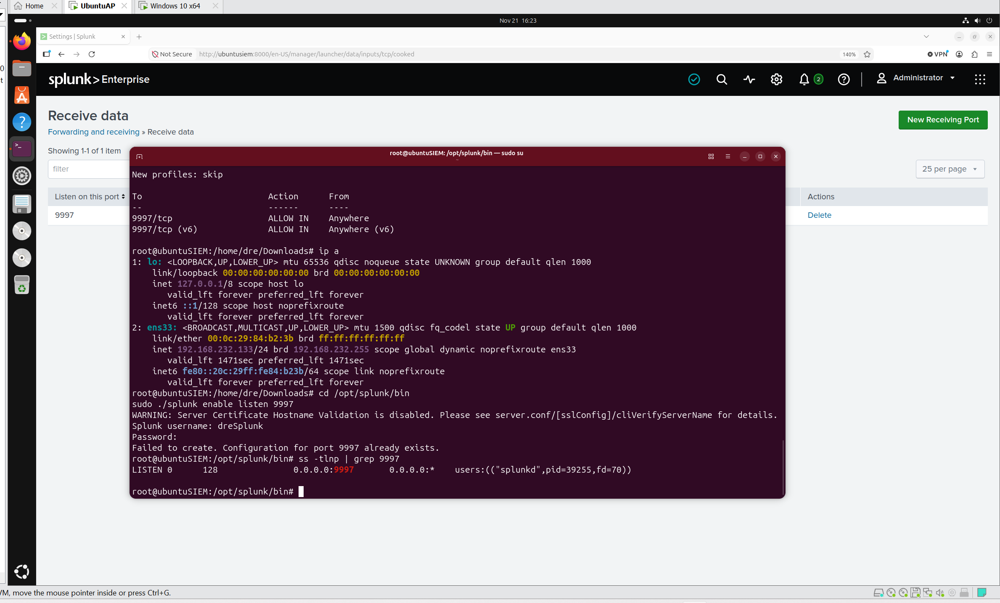
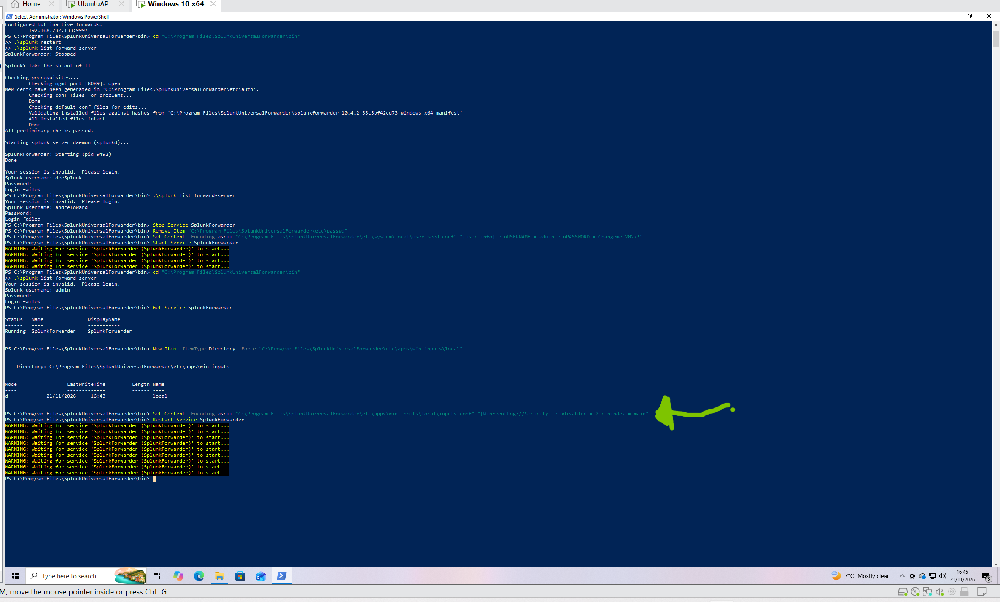
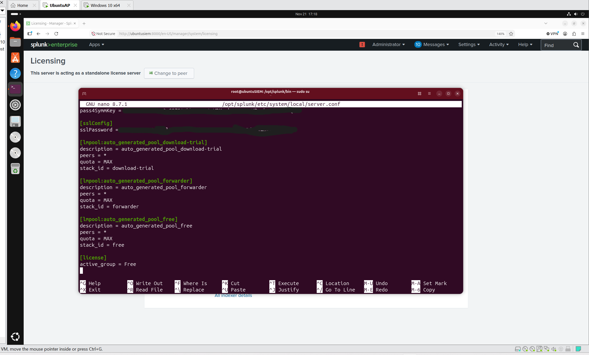
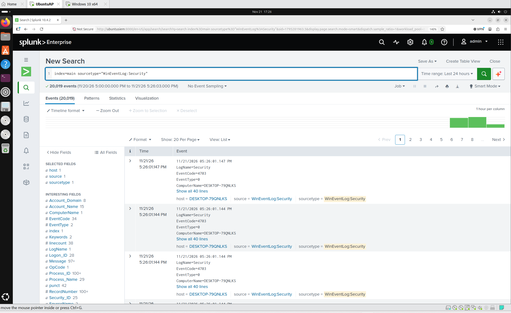
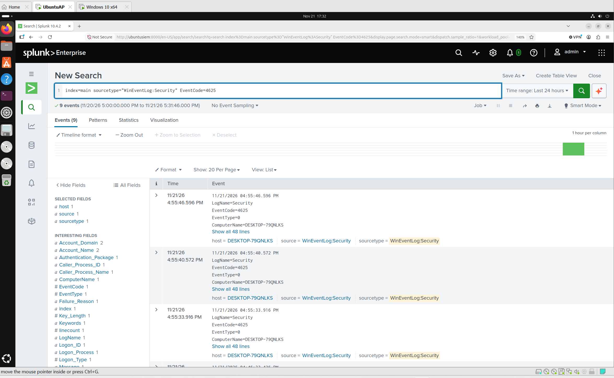
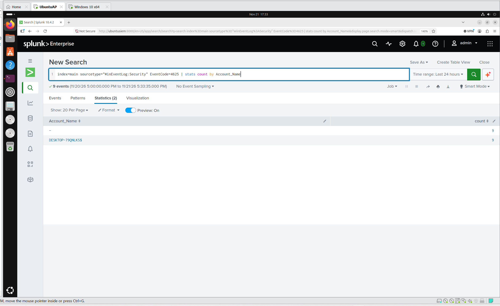

# Splunk SIEM Lab - Forwarding & Detecting Windows Failed Logons

A home SOC lab where I set up a **Splunk indexer** on Ubuntu and a **Splunk Universal Forwarder** on Windows 10, shipped the Windows Security event log across to Splunk, and detected failed-logon (brute-force) activity with SPL. This is the same forwarder-to-indexer design a real Security Operations Centre uses.

**Tools:** Splunk Enterprise (Free licence), Splunk Universal Forwarder, VMware Workstation, Ubuntu, Windows 10
**Skills:** SIEM deployment, log forwarding, SPL searching, Windows event-log analysis, brute-force detection, troubleshooting

------------------------------------------------------------------------------------------------------------------------------------------------------------------------------------------------------------------------

## Lab setup

|         Role          | Machine | Detail |
|-----------------------|-------------------------------------------|---------------------------------------------------------------|
| Indexer / search head | Ubuntu VM (`ubuntuSIEM`, 192.168.232.133) |        Splunk Enterprise, receiving on TCP 9997               |
|    Log source         |    Windows 10 VM (`DESKTOP-79QNLKS`)      | Splunk Universal Forwarder, monitoring the Security event log |
|     Network           |      VMware NAT (192.168.232.0/24)        |              Both VMs on the same network                     |

```
Windows 10 VM                         Ubuntu VM
+---------------------+               +------------------------+
| Universal Forwarder | --- 9997 ---> | Splunk indexer / search|
| (Security event log)|   (TCP)       | index=main             |
+---------------------+               +------------------------+
```

------------------------------------------------------------------------------------------------------------------------------------------------------------------------------------------------------------------------


## What I did

### 1. Installed the Splunk indexer (Ubuntu)
Ran Splunk Enterprise on the Ubuntu VM and enabled it to receive forwarded data on **port 9997**.

```bash
sudo /opt/splunk/bin/splunk enable listen 9997
sudo ufw allow 9997/tcp          # open the firewall
ss -tlnp | grep 9997             # confirm splunkd is listening
```



### 2. Installed the Universal Forwarder (Windows 10)
Installed the forwarder and pointed it at the Ubuntu indexer, then set it to monitor the Security event log.

```powershell
# Forwarder configured with receiving indexer 192.168.232.133:9997
# Security log input (inputs.conf):
# [WinEventLog://Security]
# disabled = 0
# index = main
```



### 3. Set the correct licence
The 60-day Enterprise trial had expired, which blocks searching. I switched the server to the **Free licence** (500 MB/day, permanent) via `server.conf` and restarted Splunk.

```ini
[license]
active_group = Free
```



### 4. Generated and received the logs
On Windows I locked the screen and entered the wrong password several times to create failed-logon events, then confirmed the data arrived in Splunk.

```spl
index=main sourcetype="WinEventLog:Security"
```

Over 20,000 Windows security events flowed from the forwarder into Splunk (host `DESKTOP-79QNLKS`).



### 5. Detected the failed logons (the SOC task)
Narrowed the search to **Event ID 4625 - an audit failure (failed logon)**, the event a SOC analyst watches for brute-force attempts.

```spl
index=main sourcetype="WinEventLog:Security" EventCode=4625
```



### 6. Grouped the failures by account
Used a `stats` command to count failures per account, which is how an analyst spots which account is being targeted.

```spl
index=main sourcetype="WinEventLog:Security" EventCode=4625
| stats count by Account_Name
```



------------------------------------------------------------------------------------------------------------------------------------------------------------------------------------------------------------------------


## Key Windows logon event IDs

| Event ID |       Meaning       |                       Why it matters                                  |
|----------|---------------------|-----------------------------------------------------------------------|
| **4625** |    Failed logon     | Repeated 4625s from one source = possible brute-force attempt         |
| **4624** | Successful logon    | A 4624 right after many 4625s = a brute-force that may have succeeded |
| **4740** | Account locked out  |       The result of too many failed attempts                          |

------------------------------------------------------------------------------------------------------------------------------------------------------------------------------------------------------------------------


## What I learned

- **Forwarder-to-indexer architecture.** A Universal Forwarder collects logs on the endpoint and ships them to a central Splunk indexer over port 9997, exactly how log collection works in a real SOC.
- **Reading the pipeline when it breaks.** A "connection refused" (Winsock 10061) meant the receiver wasn't listening; I checked the port with `ss`, opened the firewall with `ufw`, and confirmed the forwarder connected.
- **Splunk licensing.** An expired Enterprise trial stops search; the Free licence (500 MB/day) is the right choice for a lab.
- **SPL for detection.** Filtering on `EventCode=4625` and grouping with `stats count by Account_Name` turns raw logs into a usable brute-force signal.

------------------------------------------------------------------------------------------------------------------------------------------------------------------------------------------------------------------------


## Repository

Part of my cybersecurity home-lab portfolio: [github.com/aap-soc](https://github.com/aap-soc)
